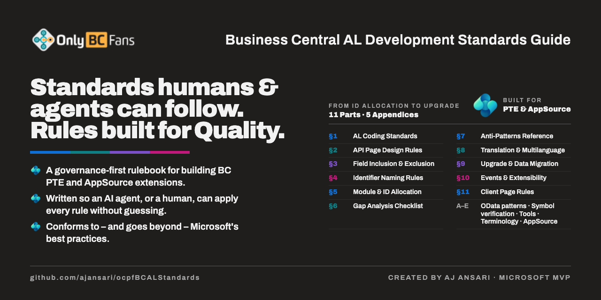

# OnlyCopilotFans Business Central AL Development Standards



**Created by:** AJ Ansari, OnlyCopilotFans  
**Last Updated:** October 10, 2026 · **Current release:** `v1.12.0.0`  
**License:** MIT

A governance-first rulebook for building Microsoft Dynamics 365 Business Central **Per-Tenant Extensions (PTEs)** in AL, written so that an AI agent — or a human — can apply every rule without guessing. It is the standalone home of the *OCPF AL Development Standards Guide*, the single source of truth that projects fetch at a pinned release tag.

> **One line that says what this is for**
>
> [alguidelines.dev](https://alguidelines.dev) answers *"how do I write idiomatic AL patterns?"* This guide answers *"how does an AI agent build a governed, AppSource-grade PTE end to end without a human holding its hand?"*
>
> When we went looking, that second question had no published answer anywhere.

---

## Contents

- [What this is](#what-this-is)
- [What this is not](#what-this-is-not)
- [Who it is for](#who-it-is-for)
- [What is inside](#what-is-inside)
- [How to use it](#how-to-use-it)
- [Did we need yet another standards guide?](#did-we-need-yet-another-standards-guide)
- [Rule numbering is stable](#rule-numbering-is-stable)
- [Related projects](#related-projects)
- [Versioning](#versioning)
- [Contributing](#contributing)
- [License](#license)

---

## What this is

The guide is a set of **rules, not patterns**. Each rule is written to be applied mechanically during an agentic build: it names the decision, ties it to a parameter the project already owns, says how to verify it against the shipped symbol files or Microsoft Learn, and states what "done" looks like. The rules cover:

- **Coding standards** — file headers, `NoImplicitWith`, indentation, dead code, file naming, and label syntax instead of multilanguage properties.
- **API page design** — OData keys, the editable versus read-only page matrix and its `DelayedInsert` rules, document-type filtered pages, header/line pages, camelCase naming, and tooltips as self-describing schema.
- **Field inclusion and exclusion** — what belongs on an API page, what must be left off, and how to verify each field against the symbols rather than memory.
- **Identifier naming** — camelCase, the Business Central standard abbreviations, reserved-keyword conflicts, and the `EntitySetName` / `EntityName` character limits.
- **Module and ID allocation** — grouping objects into modules before allocating, growth-buffer math, localization-aware field-ID ranges, permission sets as first-class deliverables, and why permission-set Role IDs must be unique across *every* extension you ship.
- **Gap analysis** — the checklist for finding the analytical, posted, reference, secondary, and tax tables that a first pass always misses.
- **Anti-patterns** — the things that compile, pass a demo, and fail in production.
- **Translation and multilanguage** — source language, XLIFF files, locked versus translatable captions, terminology from Microsoft's own translations, translation states and approval, language support by market, and the AppSource rules.
- **Upgrade and data migration** — when upgrade code is required, upgrade tags, the two-version deprecation cycle, and testing upgrades instead of hoping.
- **Events and extensibility** — subscribe rather than modify, publishing events, and treating a published event signature as a promise.
- **Client page rules** — the parent–child filter-group defect that silently drops child records, and number-series fields that get their lookup from `TableRelation`. Both come from real client defects.
- **AppSource** — the manifest properties and submission checklist that apply only when the extension is headed for the marketplace rather than a single tenant.

Every platform claim in the guide is verified against official Microsoft Learn documentation or the shipped symbol files, with a dated citation, rather than asserted from memory. Symbol-file verification is not a suggestion in this guide; it is a mandatory discipline with its own procedure (Appendix B).

## What this is not

- **Not a design-pattern catalog.** The guide does not try to teach you the dozens of implementation patterns the community has already documented. For reusable, bug-derived AL patterns see the companion [OCPF BC AL Patterns](https://github.com/ajansari/ocpfBCALPatterns) library; for the broad community catalog see [alguidelines.dev](https://alguidelines.dev).
- **Not a feature blueprint.** The guide holds rules, not a worked design. For how to build a complete Business Central Copilot feature on a specific BC version, see the [OnlyBCFans BC Copilot Blueprint](https://github.com/ajansari/obcfBCCopilotBlueprint).
- **Not a build process.** Intake, batching, compile cadence, review gates, sign-offs, and project-document templates belong to whatever build process you run. The guide holds the AL rules that a process applies, and stays silent on the sequence.
- **Not a copy of your project's parameters.** Every name, ID range, prefix, namespace, and version comes from *your* project's own parameter sheet. The guide never restates them, so the two can never drift apart.
- **Not test-project scaffolding.** AL-Go workspace structure and test-project layout are out of scope here by design.
- **Not a style opinion piece.** Where a rule exists, it exists because a defect, a Microsoft requirement, or a verifiable platform behavior made it necessary.

## Who it is for

- **AI coding agents** (Claude Code, GitHub Copilot, and others) that are asked to design, build, translate, upgrade, and ship a Business Central extension with minimal human intervention. The guide is written so an agent can cite a rule by number, apply it, and verify it.
- **Human AL developers and consultants** who want a single, verified reference for the decisions that are easy to get wrong and expensive to fix later: ID allocation, permission sets, translations, upgrades, API surface.
- **Reviewers** who need something concrete to review *against*. "Standards §5.4" is a finding; "I don't like this" is not.

## The guide

**[`ocpfALDevStandardsGuide.md`](ocpfALDevStandardsGuide.md)** — Parts 1–11 and Appendices A–E, one file. Pin a release tag when you fetch it:

```
https://raw.githubusercontent.com/ajansari/ocpfBCALStandards/v1.12.0.0/ocpfALDevStandardsGuide.md
```

## What is inside

The guide is one file, [`ocpfALDevStandardsGuide.md`](ocpfALDevStandardsGuide.md), organized so that any rule can be cited as **Standards §** plus its number.

| Section | Covers |
|---|---|
| Part 1 — AL Coding Standards | File header, `Rec.` qualification, API page template, mandatory field properties, dead code, indentation, label syntax, file naming |
| Part 2 — API Page Design Rules | OData key, editable vs. read-only pages, `SourceTableView` filtered pages, header and line pages, captions, tooltips, camelCase API naming |
| Part 3 — Field Inclusion & Exclusion Rules | Fields to include, fields to exclude, obsolete code functions, field verification |
| Part 4 — Identifier Naming Rules | camelCase identifiers, BC standard abbreviations, reserved keyword conflicts, entity name character limits |
| Part 5 — Module & ID Allocation Strategy | Logical modules, growth buffers, permission sets as deliverables, permission-set name uniqueness across extensions, object ID ranges and the deployment target |
| Part 6 — Gap Analysis Checklist | Analytical detail tables, posted/archived versions, reference tables, secondary document types, modern vs. legacy tables, tax framework tables |
| Part 7 — Anti-Patterns Reference | The recurring mistakes and what to do instead |
| Part 8 — Translation & Multilanguage Rules | Source language, translation files, labels and locked text, option and enum captions, terminology, API caption locking, translation states, language support by market, AppSource |
| Part 9 — Upgrade and Data Migration | When upgrade code is required, the upgrade codeunit, upgrade tags, the two-version deprecation cycle, side effects, upgrade testing |
| Part 10 — Events and Extensibility | Subscribe never modify, publishing events, event signatures as promises, extensibility as a recorded design decision |
| Part 11 — Client Page Rules | Parent–child pages and filter groups, number-series fields and Business Foundation numbering, the sandbox checks that prove both |
| Appendix A | OData API endpoint patterns |
| Appendix B | BC symbol file verification procedure |
| Appendix C | Recommended VS Code extensions and tools |
| Appendix D | Terminology verification procedure |
| Appendix E | AppSource manifest and submission requirements |

## How to use it

**As a human developer.** Read Parts 1 through 5 before you allocate a single object ID. Keep Part 8 open while you write captions. Read Part 9 before you rename or remove anything that has shipped. Use Part 6 as a checklist at the end of requirements analysis.

**As an AI agent, or when directing one.** Put the guide in your project repository (or fetch it at a pinned tag), give the agent your project's parameter sheet, and instruct it to:

1. Apply the guide's rules and cite them by number in code review findings, change logs, and design documents (for example, *"Standards §8.6 — API caption locked"*).
2. Verify every field, table, and enum against the downloaded symbol files, following Appendix B, before writing code that references it.
3. Never hardcode a publisher, prefix, namespace, version, or ID that the parameter sheet owns.
4. Treat any disagreement between the guide and the agent's memory as a signal to check the symbols or Microsoft Learn, not to trust memory.

The guide is process-agnostic. It works under any build process, from a one-page checklist to a full multi-step agentic runbook, because it holds only the rules and leaves the sequence to you.

**To cite a rule.** Use the section number and a short title: *Standards §5.4 — permission-set names unique across extensions*. Numbers never change (see below), so a citation written today is still correct in a later release.

## Did we need yet another standards guide?

This is the fair question, and it deserves a straight answer rather than a sales pitch. The Business Central community already has [alguidelines.dev](https://alguidelines.dev), backed by the [microsoft/alguidelines](https://github.com/microsoft/alguidelines) GitHub repository. Why not contribute there instead?

Because the two documents barely overlap in ambition. They are different animals, and both are useful.

### What each one is

| | alguidelines.dev | This guide |
|---|---|---|
| **Kind of document** | Community-owned pattern catalog and style guide | Governance-first rulebook |
| **Scope** | Broad and general-purpose: design patterns collected since 2013, C/AL-era coding guidelines, and the newer AI-oriented *Vibe Coding Rules* | Narrow and deep: agentic, per-tenant-extension development with full lifecycle governance |
| **Unit of content** | A pattern: a problem, a solution, sample code | A rule: a decision, the parameter it depends on, how to verify it, what "done" means |
| **Strength** | Breadth of implementation patterns and a long community pedigree | Every rule ties to the project's own parameters and to symbol-file or Microsoft Learn verification, with dated citations |
| **Known limitation** | Parts are explicitly dated (the C/AL Coding Guidelines were published in 2015 and say they "might fall out of sync"); at least one page (`CaptionML`) conflicts with current AL/XLIFF practice | Deliberately silent on pattern catalogs and generic test-project scaffolding |
| **Primary reader** | A developer looking up how to write something well | An agent (or a person directing one) deciding what to build, in what order, and how to prove it is right |

### What this guide covers that alguidelines.dev does not

Our comparison found 24 topics in this guide on which alguidelines.dev says nothing, or nearly nothing. The nine we rate as most significant:

1. **Permission-set Role-ID collision analysis** — extensions that share a prefix produce colliding Role IDs, and namespaces silently mask the problem until deployment.
2. **The editable versus read-only API page matrix** — driven by data mutability, with the `DelayedInsert` rules that follow from it.
3. **Localization-aware field-ID range logic** — W1 ranges (1–9,999 and 99,000,000+) versus the ranges reserved by specific localizations.
4. **Growth-buffer math for object-ID allocation** — the percentage table and tail-block reservations, so a module does not run out of IDs in its second release.
5. **Parent–child page filter-group defect analysis** — child records created in the parent's context losing the parent key, from real client defects (Part 11).
6. **Translation state governance** — locked versus translatable captions and the full state model from source string to approved translation.
7. **Symbol-file verification as a mandatory discipline** — never trust model memory or a doc page when the symbols are on disk.
8. **Upgrade and data-migration governance** — upgrade tags, the two-version deprecation cycle, and upgrade testing as a gate.
9. **The agentic lifecycle architecture itself** — the split between a process document and a rules document, zero-error gates, and pre-flight checklists that an agent runs on its own output.

The remaining fifteen are smaller and are listed in [docs/ComparisonWithALGuidelines.md](docs/ComparisonWithALGuidelines.md).

### Where alguidelines.dev is stronger

Honesty cuts both ways. alguidelines.dev is stronger in two areas this guide does not attempt:

- **Design-pattern breadth.** Dozens of implementation patterns, contributed and refined by the community over more than a decade. This guide has no ambition to replicate that.
- **AL-Go and test-project workspace guidance.** How to lay out a test project and an AL-Go workspace is scoped out of this guide by design.

If you want to know *how to write* a piece of AL well, start there. If you want to know *whether an agent built the right thing, in a way that will survive the next release and an AppSource review*, start here.

### Why not just contribute this to alguidelines.dev?

We considered it. Three reasons we did not:

- **Different premise.** alguidelines.dev is a catalog: entries are independent, and a reader picks the ones they need. This guide is a rulebook: rules reference each other by number, tie to a project's parameter sheet, and are meant to be applied as a whole by an agent that does not get to pick. Splitting it into catalog entries would lose the thing that makes it useful.
- **Different verification contract.** Every rule here carries a dated citation to Microsoft Learn or a symbol-file reference, and the append-only numbering below is a promise that downstream runbooks depend on. That is a heavier editorial contract than a community catalog should have to carry, and it would be unfair to ask them to adopt it.
- **Different release cadence.** Projects pin this guide at a release tag. That needs a repository whose tags mean something specific to the agentic build process consuming them.

None of this is a criticism of alguidelines.dev. Where a rule in this guide generalizes into a pattern that belongs in the community catalog, contributing it upstream is welcome and encouraged. The two are complementary: one is a community pattern reference, the other is an agentic governance rulebook for building compliant, symbol-verified, translation-governed, upgrade-safe Business Central extensions end to end.

## Rule numbering is stable

Downstream documents cite rules by number. To keep those citations valid across releases, the guide commits to **append-only numbering**:

- Parts, sections, and appendices are never renumbered.
- A new rule gets the next free number in its Part.
- A retired rule keeps its number and its heading, with a one-line *"retired in vX.Y"* note in place of the body.

This is the one contract that makes it safe for another document to say *"Standards §8.6"* and mean the same thing next year. See [CONTRIBUTING.md](CONTRIBUTING.md).

## Related projects

- **[OCPF BC AL Patterns](https://github.com/ajansari/ocpfBCALPatterns)** — the companion pattern library: reusable AL patterns, each extracted from a real defect, verified against Microsoft Learn or the symbol files. Where this guide says *what the rule is*, a pattern shows *the code that satisfies it*.
- **[OnlyBCFans BC Copilot Blueprint](https://github.com/ajansari/obcfBCCopilotBlueprint)** — a verified, end-to-end reference for building a whole Business Central Copilot feature in AL (Microsoft-billed and Partner-billed). The Blueprint obeys this guide; where the two seem to disagree, the guide wins and the Blueprint has a bug.
- **The OnlyCopilotFans BC Agentic Dev Framework** — an end-to-end agentic runbook for Business Central extensions. It is one consumer of this guide: it fetches the guide at a pinned tag into each project and cites its rules by number. The guide does not depend on the framework, and works under any other process.
- **[alguidelines.dev](https://alguidelines.dev)** — the community AL pattern catalog and style guide. Read it alongside this guide, not instead of it.

## Versioning

The guide carries its own version and date in its header, and this repository tags each release. Consumers should pin a tag rather than tracking `main`. The history of changes is in [CHANGELOG.md](CHANGELOG.md).

Version numbers follow `major.minor.patch.build`:

- **major** — a change that could invalidate how a consumer applies the guide (rare; numbering is never one of them).
- **minor** — a new rule, section, or appendix.
- **patch** — a corrected rule, an updated citation, or a clarified wording.
- **build** — typos and formatting.

## Contributing

Contributions are welcome, with three expectations: keep numbering append-only, back every platform claim with a dated citation to Microsoft Learn or a symbol-file reference, and never introduce a project-specific parameter into the guide. Details are in [CONTRIBUTING.md](CONTRIBUTING.md).

## License

MIT, copyright AJ Ansari and OnlyCopilotFans. See [LICENSE](LICENSE).
